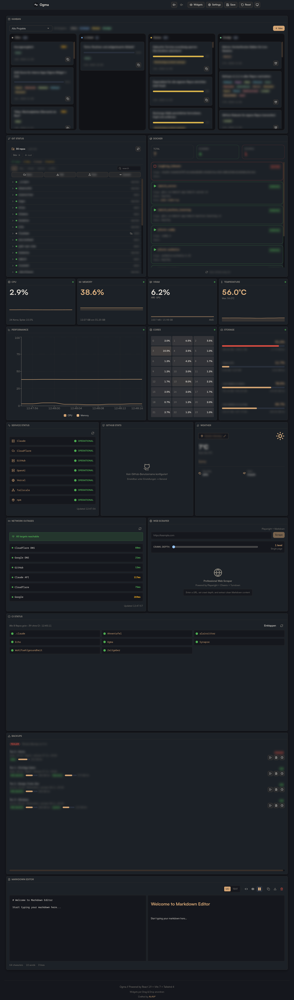
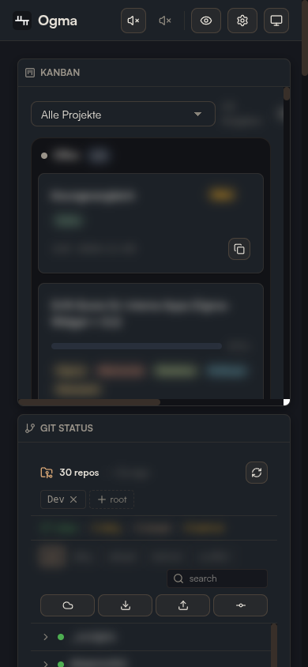

# Ogma

Developer dashboard for my own workstation: system metrics, Git repos, Docker, service status and a Kanban board for Claude Code tasks in one view.

<p align="center">
  
  
</p>


## Why

I wanted one place on my workstation for what I otherwise check in five terminals: load and temperatures while local models run, which repos are dirty or behind, which containers and upstream services are up, and what Claude Code is working on. Everything is read locally; nothing leaves the machine except weather and status-page queries.

## Run

```sh
git clone https://github.com/alainritter/Ogma.git
cd Ogma
pnpm install
pnpm dev:all   # UI http://localhost:5180, API http://localhost:3010
```

Requires Node.js 22+ and pnpm. Docker and Playwright are optional per widget.

## Notes

- The backend binds to `127.0.0.1` and has no authentication by default. For LAN access set `BIND_HOST` and `DASHBOARD_TOKEN`; see [configuration](docs/configuration.md).
- Colors, type scale and components come from a private sibling checkout (`../Harmonia`), so a fresh clone does not build without it.
- No test framework or CI; `pnpm build` and `pnpm lint` are the checks.
- Details: [widgets](docs/widgets.md), [configuration and security](docs/configuration.md), [API](docs/api.md), [development](docs/development.md).

## License

MIT, see [LICENSE](LICENSE).
